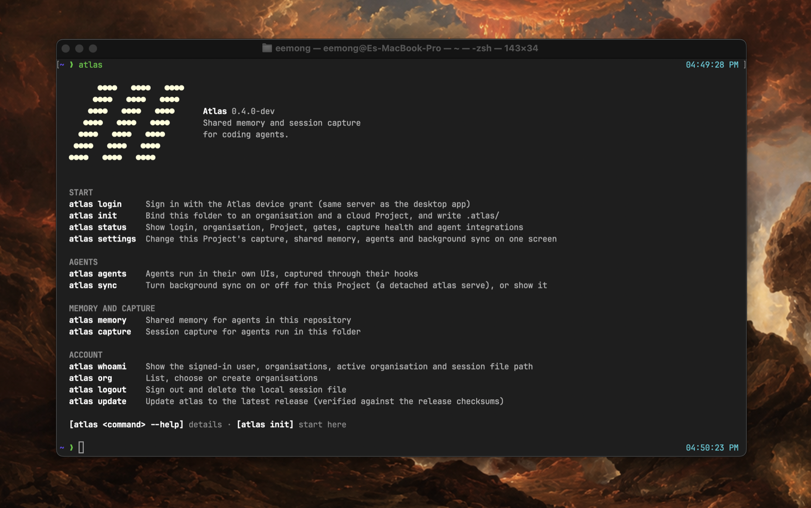

<p align="center">
  
</p>

<h1 align="center">Atlas CLI</h1>

<p align="center">
  <b>Shared memory and session capture for coding agents, from the terminal.</b><br>
  Claude Code, Codex, Cursor, Copilot, OpenCode, Droid, Antigravity and Pi keep their own UIs;<br>
  Atlas records every session and gives every agent the same memory of the project.
</p>

<p align="center">
  <a href="https://github.com/tryatlas/atlas-cli/releases/latest"></a>
  
  
  <a href="LICENSE"></a>
</p>

<p align="center">
  <a href="#install">Install</a> ·
  <a href="#quick-start">Quick start</a> ·
  <a href="#shared-memory">Shared memory</a> ·
  <a href="#session-capture">Session capture</a> ·
  <a href="#agents">Agents</a> ·
  <a href="#commands">Commands</a>
</p>

---

`atlas` is the headless Atlas: one Go binary that signs in like the Atlas
desktop app, binds a folder to an organisation and a cloud Project, and plugs
into the hooks of the agents you already use. It writes the same files the app
writes, byte for byte, so a folder works the same whether it is open in the app,
in a terminal on a server, or both.

## Install

macOS (Apple silicon, Intel) and Linux (amd64, arm64):

```sh
curl -fsSL https://github.com/tryatlas/atlas-cli/releases/latest/download/install.sh | sh
```

The installer verifies the archive's sha256 and puts `atlas` in `~/.local/bin`
(`ATLAS_INSTALL_DIR` changes it, `ATLAS_VERSION=v0.4.0` pins it). Later,
`atlas update` does the same in place. From source: `make build` (pure Go, no
cgo).

## Quick start

```sh
atlas login          # sign in (the same account as the desktop app)
cd ~/work/backend
atlas init           # organisation → Project → agents → background sync
claude               # …or codex, cursor-agent, opencode, copilot: work as usual
atlas status         # what was captured, what synced, what agents remember
```

`atlas init` is a guided flow on a terminal:

| step | asks |
|---|---|
| 1 · Organisation | which organisation the folder belongs to (skipped when you have one) |
| 2 · Project | the cloud Project: the one matching this repository first, the others, or a new one |
| 3 · Agents | which agents found on this machine to hook, with an **All agents** row |
| 4 · Background sync | keep a listener running so every event reaches the cloud at once |
| 5 · Memory search | download the local search model (87 MB, once) when it is missing |

`--local` binds without a cloud. In scripts, flags answer instead: `--org`,
`--project | --create`, `--agents claude-code,codex | --all-agents`,
`--sync on|off`.

`atlas settings` changes any of it later on one screen: account, capture and
memory, each agent, background sync, the local model, updates.

## Shared memory

Every agent in the project reads and writes one memory, through the
`atlas_memory` MCP server that `atlas agents add` registers in the agent's own
config. Nothing is ever injected into a prompt: agents pull what they need.

| tool | what an agent gets |
|---|---|
| `memory_briefing` | at session start: the active **plan**, recent file changes, decisions, facts, failures, architecture, conventions, and the previous session's handoff |
| `memory_search` | memories ranked by **meaning and words**, plus the project's **documents** (CLAUDE.md, AGENTS.md, notes, captured sessions) |
| `memory_remember` | save a decision, fact, failure, architecture note or preference; near-duplicates merge |
| `memory_changes` | what other sessions recorded since this one last looked |
| `memory_get` · `memory_history` · `memory_why` | one memory, its earlier wordings, and the sessions behind a file or commit |
| `memory_forget` · `memory_feedback` · `memory_list` | remove, rate and list |

- **Search by meaning.** A small local model (MiniLM, the one the app uses) runs
  in pure Go on your machine; nothing is sent anywhere. Ask "how do we rotate
  tokens" and find "signing keys rotate every week". Without the model, search
  falls back to words.
- **Plans are captured, not typed.** When an agent writes its to-do list
  (`TodoWrite`, `update_plan`, `todowrite`, Claude's tasks and plan mode, …),
  it becomes the project's plan, and the next session, or another agent, sees
  it in its briefing.
- **Memories write themselves.** Decisions an agent states in its reply, and
  what the extractor distils from long sessions, land as memories; at session
  end a handoff note tells the next session where things stand.
- **One record with the app.** `.atlas/memory/` holds the app's exact files:
  `memory.sqlite` (with its vectors), `corpus.sqlite`, `memory.snapshot.sqlite`
  (a daily backup, restored automatically if the record is damaged) and
  `extract-state/`.

```sh
atlas memory browse   # entries by kind, search, history
atlas memory index    # embed every memory, index the project's documents
```

## Session capture

Capture happens per event, as the agent works:

1. **The prompt** opens the turn the moment you submit it.
2. **Each tool call** lands as the agent's post-tool hook fires, with the files it
   wrote, including files a shell command changed.
3. **The reply** closes the turn at the agent's stop hook, with token usage and
   the model, read from the transcript the agent names.
4. **Commits** an agent makes get their checkpoint: a git `post-commit` hook
   links each commit to the session and turn that wrote it.

Every event reaches the cloud Project within seconds: the hook writes the store
and syncs, or hands the event to `atlas serve`, or spools it while the desktop
app has the folder open. A hook never fails the agent; problems go to
`atlas status`.

```sh
atlas sync on         # a background listener your agents' hooks keep alive
atlas serve           # the same in the foreground, with a live feed of hook events
```

## Agents

`atlas agents add <agent>` writes the hook and the memory server into the
agent's own config in the project; `atlas agents remove` takes them out.
Nothing is wrapped and no environment variable changes.

| agent | hook written to | memory server written to |
|---|---|---|
| `claude-code` Claude Code | `.claude/settings.local.json` | `.mcp.json`, approved in the local settings |
| `codex` Codex | `.codex/hooks.json`: choose **Trust all and continue** once | `.codex/config.toml` |
| `cursor` Cursor CLI and IDE | `.cursor/hooks.json` | `.cursor/mcp.json`, approved once in Cursor |
| `copilot` GitHub Copilot CLI | `.github/hooks/atlas.json`, once the folder is trusted | `.github/mcp.json` |
| `opencode` OpenCode | `.opencode/plugins/atlas.ts` | `opencode.json` |
| `droid` Factory Droid | `.factory/settings.json` | `.factory/mcp.json` |
| `antigravity` Antigravity (`agy`) | `.agents/hooks.json` | `.agents/mcp_config.json` |
| `pi` Pi | `.pi/extensions/atlas/index.ts`, once the project is trusted | `.pi/mcp.json` |

Keep `atlas` current on `PATH`, including `~/.local/bin`, which some agents put
first.

## Commands

Every command draws its own screen on a terminal (the Atlas palette: monochrome,
colour only for status) and prints plain text to pipes and scripts.

| command | what |
|---|---|
| `atlas` | the overview: logo, commands by group |
| `atlas login` · `logout` · `whoami` | sign in with the device grant; the session file is the only secret kept (mode 0600) |
| `atlas org list \| use \| create` | organisations |
| `atlas init` | bind the folder, hook the agents, choose background sync and memory search |
| `atlas settings` | everything on one screen |
| `atlas status` | sign-in, Project, capture health, commits linked, sync, memory, agents |
| `atlas agents add \| remove \| list \| sessions` | the hooks and memory entry per agent; the sessions seen |
| `atlas sync [on \| off]` | background sync |
| `atlas serve` | the Project's listener: memory server, sync drain, receiver of hook events |
| `atlas memory browse \| list \| index \| verify \| export \| import` | shared memory |
| `atlas memory enable \| disable` | the shared-memory gate for this repository |
| `atlas capture enable \| disable \| sync \| retry \| link` | the capture gate; sync now, retry failed rows, link commits |
| `atlas update [--check] [--version vX.Y.Z]` | replace this binary with a release, checksum verified |

## What lives where

| path | what |
|---|---|
| `.atlas/` | the app's per-project files only: `sessions.db`, `blobs/`, `memory/`, `project.json` |
| `~/.local/state/atlas-cli/projects/<hash>/` | the CLI's own: hook state, `hooks.log`, the listener's run file, preferences |
| `~/Library/Application Support/dev.atlas.ide/models/` | the local search model, shared with the app (`~/.local/share/…` on Linux) |

## Development

```sh
make build    # ./bin/atlas
make test     # go test ./...
make lint     # golangci-lint
```

| doc | what |
|---|---|
| `docs/progress.md` | what was built, what was verified live, what was not |
| `docs/adr/` | decisions; `0013` is capture through agents' hooks |
| `docs/research/entire-cli.md` | the per-agent hook facts the integrations follow |
| `docs/atlas-reference/` | the desktop app's specification and file formats |
| `docs/RELEASE.md` | how to release, and the acceptance checklists |

Ground rules: a hook reads only the transcript file the agent's own payload
names, from the turn's offset, while the hook runs, and never scans an agent's
folders; memory is never injected into prompts; an `Authorization` header is
never logged; every stored text passes the redactor; no secret persists except
the session token file.

The ACP path of v0.1 (`atlas run <agent>`) is parked under the hidden
`atlas acp` group.

## License

[Apache-2.0](LICENSE)
